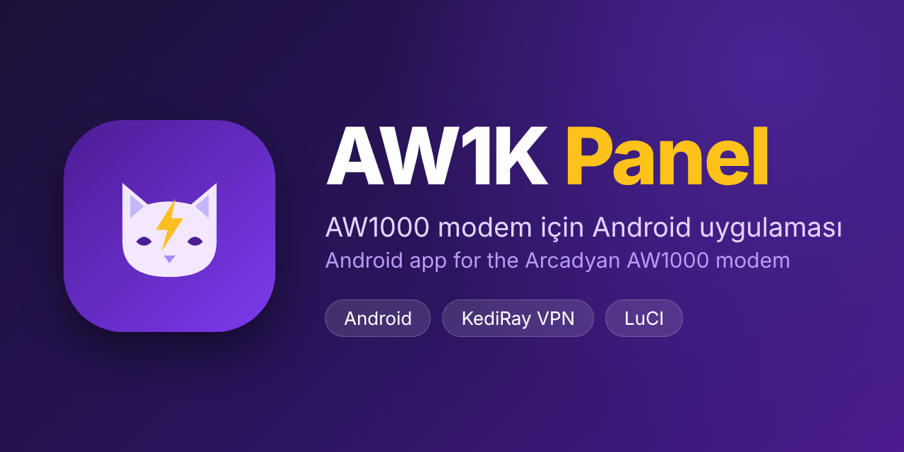
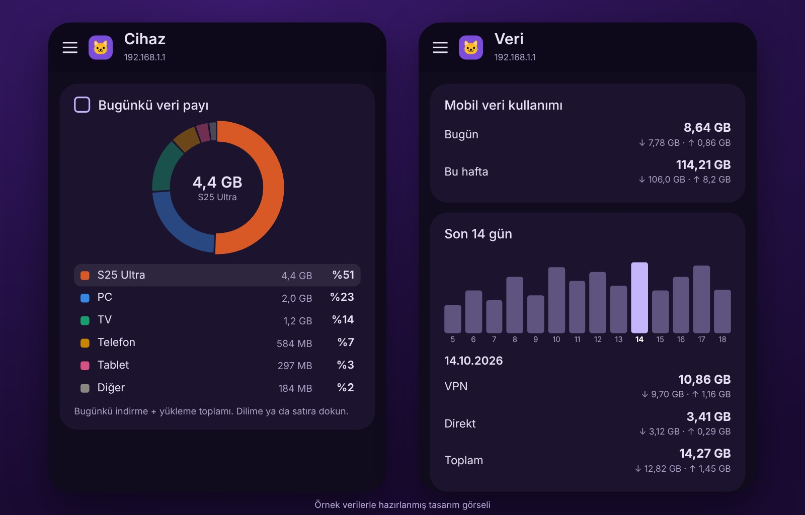

# AW1K Panel

**Türkçe** · [English](#english)

Arcadyan AW1000 (OpenWrt/LuCI) modemin için Android uygulaması. Modemin durumunu, bağlı cihazları, Wi-Fi'yi, hücresel bağlantı bilgilerini ve [KediRay VPN](https://github.com/sabanvurgun03-ui/kediray)'i telefondan yönetirsin. Geliştirici: Şaban Vurgun.

## Ekran görüntüleri

*Ana sayfa, VPN, Wi-Fi, Ağ ve Cihaz ekranları.*

*Yeni: cihazların bugünkü veri payı (halka grafiği) ve Veri sayfasında bir güne dokununca VPN / Direkt dökümü. Örnek verilerle hazırlanmış tasarım görseli.*

## Özellikler

- **Ana sayfa:** operatör, ağ tipi (LTE-A / CA), sinyal yüzdesi ve anlık hız; CPU, bellek, çalışma süresi ve yük ortalaması; modemi yeniden başlatma
- **Modem verileri:** SIM, hücre, bant ve kalite bilgileri (PCC / SCC: bant genişliği, fiziksel hücre kimliği, EARFCN, RSSI, RSRP, RSRQ, SINR)
- **Akıllı bant seçimi:** seçilen bantları tek tek dener, hız ve sinyale göre en iyisini seçer
- **Wi-Fi:** ağları açıp kapatma, ad / şifre / kanal düzenleme, ağa bağlı istemciler ve "Wi-Fi'dan engelle"
- **Cihazlar:** bağlı cihazlar, bağlı süre, cihaz başına yön (**VPN / Direkt**), engelleme; IP ve MAC gizleme; bugünkü veri kullanımının cihazlara dağılımı (halka grafiği)
- **VPN:** KediRay ve xDivine-Ray durumu, düğüm / profil yönetimi (link ya da JSON ekle, elle ekle, sertifikayı sabitle), başlat / durdur / yeniden başlat
- **KediRay güncellemesi:** yeni sürüm var mı denetle; modem indirip SHA256 ile doğrulayıp kurar
- **Günlük:** KediRay / Xray günlüğü, hata gruplama ve ne yapmalı önerileri
- **Veri kullanımı:** günlük, haftalık ve aylık; son 14 gün çubuklarından bir güne dokununca o günün **VPN / Direkt / Toplam** trafiği (indirme ve yükleme ayrı; KediRay sayacından, son 30 gün)
- **Uyarılar ve diğer:** VPN kopma uyarısı, birden fazla modem desteği
- **Temalar:** açık/koyu mod, hazır temalar, kendi renklerin ve bağlantıdan içe alma
- **Gizlilik:** IP / MAC ve sunucu adreslerini gizle (ekran görüntüsü paylaşırken işe yarar); isteğe bağlı anonim kullanım sayısı (ilk girişte sorulur, "Evet" demezsen hiçbir şey gönderilmez)

## Kurulum

1. **Modem tarafı:** modemde **KediRay 1.19.36 veya yenisi** kurulu olmalı (uygulamanın modem eklentisi onunla gelir): [KediRay kurulum](https://github.com/sabanvurgun03-ui/kediray#kurulum).
2. **Uygulama:** [Sürümler](https://github.com/sabanvurgun03-ui/aw1kpanel/releases/latest) sayfasından en son `.apk` dosyasını indir (SHA256 değeri dosyanın yanında yazar), telefonda "bilinmeyen kaynaklardan kurulum" iznini ver ve aç.
3. Telefon modemin Wi-Fi ağına bağlı olsun. Adres genelde `192.168.1.1`, kullanıcı `root`.

## Notlar

- Test edilen cihaz: Arcadyan AW1000 (DivineWRT / OpenWrt, LuCI, QModem).
- Geri bildirim ve sorunlar için bu depodaki **Issues** bölümünü kullanabilirsin.

## Destek

Beğendiysen:

---

## English

Android app for the Arcadyan AW1000 (OpenWrt/LuCI) modem. Check the modem, connected devices, Wi-Fi, cellular link details and the [KediRay VPN](https://github.com/sabanvurgun03-ui/kediray) from your phone. Author: Şaban Vurgun.

### Screenshots

*Home, VPN, Wi-Fi, Network and Devices screens.*

*New: each device's share of today's data (donut chart), and tapping a day on the Data page shows its VPN / Direct breakdown. Design preview made with sample data.*

### Features

- **Home:** operator, network type (LTE-A / CA), signal percentage and live speed; CPU, memory, uptime and load average; modem reboot
- **Modem data:** SIM, cell, band and quality info (PCC / SCC: bandwidth, physical cell ID, EARFCN, RSSI, RSRP, RSRQ, SINR)
- **Smart band selection:** tries each chosen band in turn and picks the best by speed and signal
- **Wi-Fi:** switch networks on/off, edit name / password / channel, clients per network and "block from Wi-Fi"
- **Devices:** connected devices, connected time, per-device route (**VPN / Direct**), blocking; hide IP and MAC; today's data usage per device (donut chart)
- **VPN:** KediRay and xDivine-Ray status, node / profile management (add by link or JSON, add by hand, pin the certificate), start / stop / restart
- **KediRay updates:** check for a new version; the modem downloads it, verifies SHA256 and installs it
- **Log:** KediRay / Xray log with error grouping and suggested fixes
- **Data usage:** daily, weekly and monthly; tap a day in the last-14-days bars to see its **VPN / Direct / Total** traffic (download and upload separately; from the KediRay counters, last 30 days)
- **Alerts and more:** VPN-drop alert, multiple modems
- **Themes:** light/dark mode, ready-made themes, your own colors and import from a link
- **Privacy:** hide IP / MAC and server addresses (handy for screenshots); optional anonymous usage count (asked on first launch, nothing is sent unless you say yes)

### Install

1. **Router side:** **KediRay 1.19.36 or newer** must be installed on the modem (the app's router add-on ships with it): [KediRay install](https://github.com/sabanvurgun03-ui/kediray#english).
2. **App:** download the latest `.apk` from the [Releases](https://github.com/sabanvurgun03-ui/aw1kpanel/releases/latest) page (the SHA256 is shown next to the file), allow "install from unknown sources" and open it.
3. Your phone must be on the modem's Wi-Fi. The address is usually `192.168.1.1`, user `root`.

### Notes

- Tested device: Arcadyan AW1000 (DivineWRT / OpenWrt, LuCI, QModem).
- Use **Issues** in this repo for feedback and problems.

### Support

If you like it:

